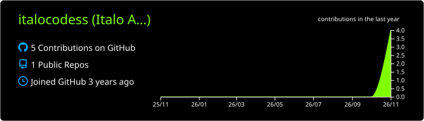
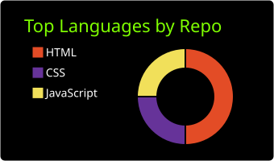
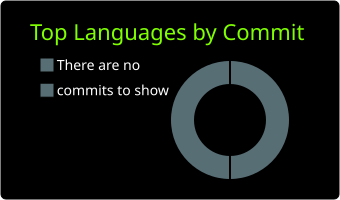
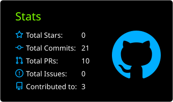
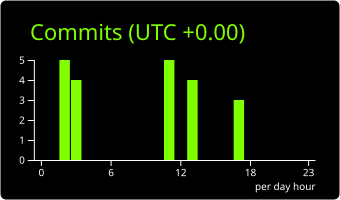

<h1 align="center">Olá, mundo! 👋 Sou o Ítalo Alves</h1>

  💻 Estudante de <b>Sistemas de Informação</b> | Desenvolvedor de Software & Entusiasta de Infraestrutura e Redes.

---

### 👨‍💻 Sobre mim

Estudante universitário apaixonado por tecnologia, desenvolvimento de sistemas robustos e manutenção de infraestrutura. Sempre explorando novas ferramentas, criando soluções eficientes e construindo projetos práticos para resolver problemas reais.

---
### 🚀 Main skills

**Redes de computadores** 🌐

---

### 🛠️ Tecnologias e Ferramentas

* **Linguagens:** C, C++, Python, Java, C#, JavaScript, TypeScript
* **Web & Banco de Dados:** HTML5, CSS3, SQL (MySQL, PostgreSQL), Node.js
* **Sistemas & Redes:** Linux (Ubuntu Server, Linux Mint), TCP/IP, Docker, Git & GitHub
* **Ambiente de Trabalho:** Visual Studio Code, NetBeans, VirtualBox, Windows

---

### 📊 Estatísticas do GitHub

 
 

